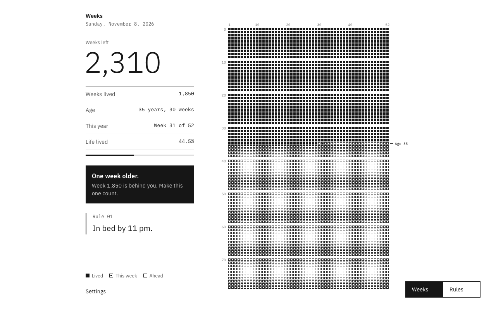
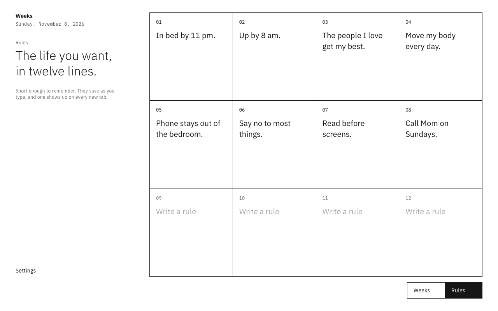
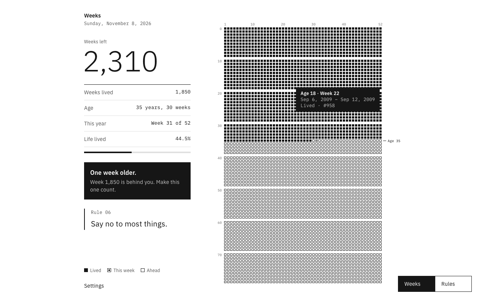

# Weeks

[](https://github.com/authenticryan/weeks/actions/workflows/ci.yml)

**Your life in weeks, on every new tab.**

Weeks is a Chrome extension that replaces the new tab page with a grid of your life. Each square is one week and each row is one year. Weeks you've lived are black, weeks you have left are white, and every Sunday another square fills in.



**Chrome Web Store:** coming soon · **Download:** [latest release](https://github.com/authenticryan/weeks/releases/latest) · **Privacy:** [nothing leaves your browser](PRIVACY.md)

---

## Why I built this

One morning I woke up thinking about how much time I have left, and how little of it I spend on purpose. Years earlier I'd seen Tim Urban's *Your Life in Weeks*: a whole human life fits on one page, about 4,000 squares. It's a sobering picture, and a useful one.

The trouble with a poster is that you stop seeing it after a week. So I put the grid where I already look dozens of times a day: the new tab page. There's no new habit to build and no app to open.

Seeing time pass isn't the same as using it well, though. So Weeks has a second view: a short list of rules for the life I actually want to live. One of them shows up every time I open a tab.

## What it does

- **Life grid.** One row per year of age, 52 squares per row. You choose the life expectancy (80 by default). Hover any square to see the dates it covers.
- **One week older.** A square fills when a new week starts, on Sunday or Monday (your choice). For the first two days of each week it blinks slowly, next to a note: *"One week older. Make this one count."*
- **Rules.** Up to 12 short rules, saved as you type. A random one appears on each new tab.
- **Private.** No account, no server, no analytics. One permission (`storage`), and a button to delete everything.

| Rules | Details on hover |
|---|---|
|  |  |

## Product decisions

In a small product, the interesting part is what you leave out and why.

| Decision | Reasoning |
|---|---|
| **Live on the new tab** | It's the most-seen surface in the browser. The reminder rides on a habit people already have instead of asking for a new one. |
| **Tick weekly, not daily** | A daily countdown turns into noise. A weekly moment is rare enough to register. |
| **Blink for two days** | If you don't open Chrome on Sunday, you still catch it on Monday. |
| **Rows start on your birthday** | Row 35 really is your 35th year. The simpler approach, dividing weeks since birth by 52, drifts about a week every six years, and people notice when their age row is wrong. |
| **Rules next to the grid** | The grid creates urgency; rules turn it into behavior. Rotating one rule per tab keeps them from becoming wallpaper. |
| **No account, no server, one permission** | It's your birthday and your personal rules. Keeping everything in the browser earns trust, keeps store review simple and leaves nothing to run. |
| **Calm, monochrome, square** | No streaks, badges or notifications. Built on IBM Carbon's white theme and IBM Plex type so it feels like a tool, not a game. |
| **Life expectancy is a setting** | Some people want 90 to feel generous; some want 60 to feel urgent. That's the user's call, not mine. |

## How it's built

- **Manifest V3, vanilla JavaScript, no build step, zero dependencies.** The store package is under 100 KB, fonts included.
- **A date model you can trust.** All date math runs on integer day numbers (days since 1970, UTC), so daylight-saving changes and time zones can't shift a week boundary. A square fills when a Sunday (or Monday) passes after your last birthday, capped at 52 per row.
- **Tested day by day.** The test suite walks every day across 50 years for awkward birthdays (29 February, 31 December, 2 January) with both week starts. It proves the grid never skips or double-fills, and that each square's date range ends exactly the day before it fills.
- **Pixel-exact SVG.** The grid is sized to whole pixels at runtime, so its 1px lines stay crisp at any window size.
- **Synced, live state.** Settings and rules live in `chrome.storage.sync`. They follow your Chrome profile across machines, and every open tab updates as you type.
- **Offline by design.** IBM Plex is bundled (Latin subsets), so the page makes zero network requests.
- **Accessible.** Keyboard-operable view switch, a settings dialog that keeps focus inside it, visible focus states and a labelled SVG. `prefers-reduced-motion` turns the blink off.
- **Release pipeline.** GitHub Actions runs the tests and builds the store zip on every push. Pushing a `v*` tag publishes a GitHub release with notes taken from the changelog, and fails if the tag and manifest versions disagree.

## Go-to-market notes

How I'd take this from side project to something people find:

- **Positioning:** for people who want to spend their time on purpose, Weeks is a new tab that shows how much life is left and the rules they've set for it. Unlike productivity dashboards, it has no tasks, streaks or feeds.
- **Discovery:** Chrome Web Store search first ("life in weeks", "memento mori", "new tab"), which is where listing quality matters. Then communities that already discuss the idea: r/getdisciplined, r/Stoicism, Product Hunt, Show HN.
- **What I'd measure:** setup completion (birthday entered), rules written per user (activation), still installed after 30 days (retention) and store rating.
- **Growth loop to test next:** a shareable poster export of your grid.

## Roadmap

- Life events: mark moments on the grid ("moved cities", "started a company")
- Poster export (PNG or PDF) to share or print
- Optional dark theme
- Edge and Firefox builds (Edge accepts the same MV3 package)

## Run it locally

1. Clone this repo.
2. Open `chrome://extensions`, turn on **Developer mode**, click **Load unpacked** and choose the `extension/` folder.
3. Open a new tab.

```sh
npm test          # date model tests
npm run package   # build dist/weeks-<version>.zip for the Chrome Web Store
npm run assets    # regenerate store screenshots and promo tiles (needs Chrome)
```

There's no `npm install` step, because there are no dependencies.

## Repository

```
extension/            The extension (load this folder unpacked)
  manifest.json       MV3 manifest: new tab override, storage permission
  newtab.html         Page markup
  styles.css          Carbon white-theme tokens, square corners
  js/life.js          Date model, pure functions
  js/store.js         chrome.storage.sync wrapper
  js/app.js           Grid, rules, settings, tooltip
  fonts/  icons/
tests/                Date model tests (Node, no dependencies)
scripts/              package.sh (store zip), store-assets.sh (screenshots)
store/                Listing copy, screenshots, promo tiles and their sources
docs/PUBLISHING.md    Chrome Web Store submission and release guide
PRIVACY.md            Privacy policy
CHANGELOG.md          Release history
```

## Versioning

[Semantic Versioning](https://semver.org/), with `extension/manifest.json` as the source of truth. Every release is a tagged commit, a [changelog](CHANGELOG.md) entry and a GitHub release with the store zip attached. The full process is in [docs/PUBLISHING.md](docs/PUBLISHING.md).

## Credits

- The idea: Tim Urban's [Your Life in Weeks](https://waitbutwhy.com/2014/05/life-weeks.html) (Wait But Why, 2014), and Bryan Braun's interactive [Your Life](https://www.bryanbraun.com/your-life/weeks.html).
- Type: [IBM Plex](https://github.com/IBM/plex), under the SIL Open Font License 1.1 (see `extension/fonts/OFL.txt`). Design tokens from IBM's [Carbon Design System](https://carbondesignsystem.com).
- Built by Ryan Dsouza, with [Claude Code](https://claude.com/claude-code) as pair programmer.
